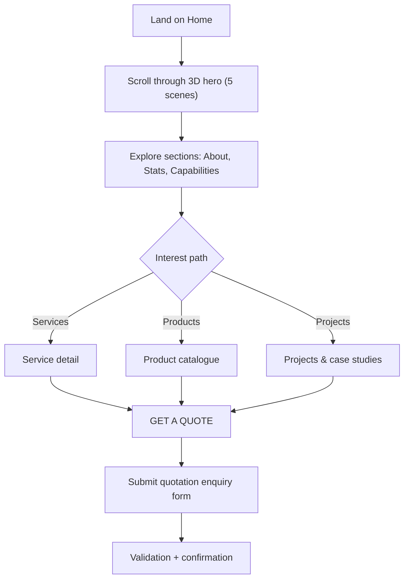

# PPIS Website — Version 2 (Luxury Light Theme) — Product Requirements Document

## 1. Product Overview

Version 2 of the PPIS corporate website — a complete visual transformation of the existing dark-navy/metallic-gold identity into a sophisticated **light luxury theme** (pearl white, ice blue, champagne, platinum, soft gold) with a scroll-driven 3D storytelling hero and premium neumorphic design language.

- **Purpose**: Present PPIS as an international-grade power infrastructure & electrical engineering company; convert visitors into quotation enquiries.
- **Audience**: Utility/EPC clients, industrial buyers, government bodies, OEM partners, and prospective employees.
- **Value**: A distinctive, production-grade digital identity where the "energy journey" 3D experience is the main attraction, backed by a full service/product/project catalogue.

> **Versioning rule**: Version 2 is built **as a separate application**. The Version 1 dark-theme site is not modified, overwritten or deleted.

## 2. Core Features

### 2.1 User Roles

Single public audience — **no login, no registration, no dashboard** (explicitly out of scope). Optional admin-side ingestion of quote leads is a future backend integration, not part of V2 UI.

### 2.2 Feature Module

1. **Home** — nav, scroll-scrubbed 3D hero, about intro, statistics, core capabilities, featured projects, product highlights, industries served, why choose PPIS, OEM partners, Get-a-Quote CTA, footer.
2. **About Us** — overview, our story, vision/mission/values, leadership, founder & MD, strengths, QHSE, certifications, our approach, geographic presence.
3. **Services** — index + detail pages for 7 services (description, technical overview, capabilities, applications, related equipment, photography).
4. **Projects** — overview, featured projects, case studies, gallery, interactive India map, testimonials, ongoing/completed.
5. **Products** — interactive catalogue with tabs + filtering, neumorphic cards, 3D hover, enquiry button, catalogue download drawer, 10 product categories.
6. **Careers** — why work with PPIS, openings, life at PPIS, culture/values, benefits, application process, resume submission.
7. **Downloads** — premium document centre with downloadable document cards and PDF icons.
8. **Contact / Get a Quote** — full contact details (address, phones, emails, WhatsApp, map, business hours) + quotation enquiry form.
9. **Policy pages** — Privacy Policy, Terms & Conditions, Cookie Policy.
10. **404** — branded not-found page.

### 2.3 Page Details

| Page | Module | Feature description |
|------|--------|---------------------|
| Home | Hero (3D) | Scroll-scrubbed frame sequence, 5 scenes (0–2s generation, 2–4s transmission, 4–6s substations, 6–8s distribution, 8–10s end-users/EV), per-scene title/subtitle overlays, scene progress rail, CTA "EXPLORE OUR SOLUTIONS", reverse-scrub support, mobile fallback |
| Home | Stats | Animated counters (projects, kilometres laid, substations, years) |
| Home | Capabilities | 6 core engineering capability cards (neumorphic, ice-blue icons) |
| Home | Featured projects | Elevated project cards with image zoom |
| Home | Product highlights | 4–6 product teasers linking to catalogue |
| Home | Industries served | Icon grid of served industries |
| Home | Why choose PPIS | Value propositions with soft depth cards |
| Home | OEM partners | Logo marquee/grid |
| About | Editorial layout | Large typography, floating image compositions, soft blue panels, timeline of story |
| About | Leadership | Leader cards (name, role, bio) |
| Services | Index | 7 service cards with hover elevation |
| Services | Detail | Per-service hero, technical overview table, capabilities, applications, related equipment, gallery |
| Projects | Map | Interactive India map with project location pins (only if verified locations available; otherwise aggregated state view) |
| Products | Catalogue | Tabs + category filter + search, cards with image, name, category, description, specs, enquiry button |
| Products | Drawer | Slide-in catalogue download drawer |
| Careers | Openings | Filterable openings list, apply flow, resume upload |
| Downloads | Doc centre | Elevated cards with PDF icons, file type/size, functional download |
| Contact | Quote form | Validated fields (full name, company, email, phone, service/product, location, estimated requirement, message), real submit handler with loading/success/error states |
| Common | Search | Site-wide search overlay indexing pages/services/products |
| Common | Nav | Sticky glass header, mobile drawer nav, GET A QUOTE button |
| Common | Footer | Quick links, contact, social, policy links, newsletter |
| Common | Utilities | Scroll progress bar, back-to-top button, cookie consent banner |

## 3. Core Process

Visitor journey (Mermaid):

## 4. User Interface Design

### 4.1 Design Style

- **Direction**: Luxury minimalism × refined neumorphism × subtle glassmorphism.
- **Palette tokens** (CSS variables):

| Token | Hex | Usage |
|-------|-----|-------|
| `--pearl` | `#F8F9F7` | Primary background |
| `--ice` | `#E6F2FA` | Secondary background |
| `--champagne` | `#E9DDC8` | Premium accent |
| `--platinum` | `#C9D1DA` | Metallic elements/borders |
| `--navy` | `#152B46` | Primary text |
| `--slate` | `#64748B` | Secondary text |
| `--gold` | `#C5A46D` | Button accent |
| `--white` | `#FFFFFF` | Card background |
| `--mist` | `#D5E7F3` | Light blue accent |

- **Neumorphism**: soft raised cards (`--elev-1/2/3`), inset surfaces, white-on-white elevation, rounded premium components, subtle metallic borders, frosted glass panels. Restraint applied for readability/contrast/accessibility.
- **Buttons**: Primary (gold surface, navy text, right arrow, hover lift + gold glow), Secondary (pearl surface, platinum border, inset shadow, gold hover indicator), Tertiary (ice-blue surface, download icon), Icon buttons (circular, elevated). 250–350ms transitions, 2–4px lift.
- **Typography**: Headings **Manrope** (ExtraBold for hero), Body **Inter**. Clear hierarchy, generous line-height, consistent weights.
- **Layout**: Spacious, alternating pearl/ice backgrounds, elevated cards, generous negative space, grid-breaking hero.

### 4.2 Page Design Overview

| Page | Module | UI Elements |
|------|--------|-------------|
| Home | Hero | Full-viewport frame canvas, pearl nav overlay, per-scene glass caption card, gold progress rail, CTA |
| Home | Stats | 4-up counter grid on ice-blue panel with inset tiles |
| Home | Capabilities | 6 neumorphic cards, ice-blue icon wells, gold hover accent |
| About | Editorial | Large display headings, floating image stack, timeline, blue panels |
| Services | Cards | Pearl cards, ice-blue icon backgrounds, silver decorative rules, gold highlights |
| Products | Catalogue | Sticky tab bar, filter chips, grid/list toggle, product drawer |
| Contact | Form | White raised inputs w/ inset neumorphism, ice-blue focus rings, gold submit |

### 4.3 Responsiveness

Desktop-first; fluid tablet and mobile adaptation. Hero falls back to a lighter frame set / static poster on low-power devices. Touch-optimized nav drawer, tap targets ≥ 44px. 60 FPS target where capable.

### 4.4 3D Scene Guidance

- **Approach**: Pre-rendered frame sequence (300 JPGs) scrubbed by scroll — matches the "optimized sequential rendered frames with scroll scrubbing" fallback and guarantees smooth, reverse-capable playback.
- **Mood/lighting**: Bright pearl-white environments, ice-blue atmospheric light, platinum-silver infrastructure, champagne-gold energy trails, soft ambient shadows.
- **Camera**: Continuous forward dolly across all 5 scenes; no cuts — interpolation is handled by frame density.
- **Scene mapping**: Scene 1 frames 1–60, Scene 2 61–120, Scene 3 121–180, Scene 4 181–240, Scene 5 241–300 (30fps over 10s).
- **Interactions**: Scroll position → frame index (lerped for smoothness); text overlays cross-fade per scene; CTA appears at final scene.
- **Performance budget**: Frames loaded progressively (low-res first-paint pass → full-res decode); preload orchestrated; capped device pixel ratio; RAF-driven draw only on scroll delta.

## 5. Content & Assets Note

The workspace currently contains only the 300 hero frames and the PPIS logo PNG. Company facts, photography, catalogue PDF and project data are supplied by the client. Until then, all such content is centralised in a single content module (`src/content/site.ts`) with clearly-labelled placeholders designed for one-point replacement. **No company information is fabricated as fact** — placeholder values are neutral and explicitly marked in code.
