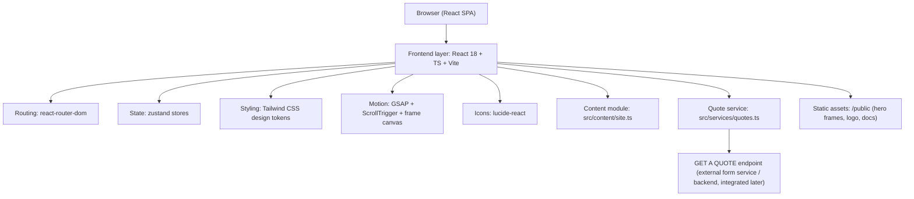
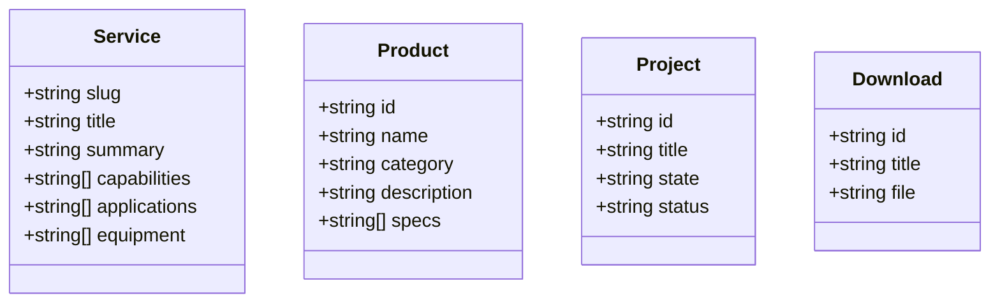

# PPIS Website Version 2 — Technical Architecture

## 1. Architecture Design



Frontend-only for V2. The quote submission service is a thin, swappable module that performs a real network POST to a configured endpoint; the concrete backend/form-service is integrated later without UI changes.

## 2. Technology Description

- **Frontend**: React 18 + TypeScript + Vite + Tailwind CSS 3
- **Initialization Tool**: `vite-init` (template: `react-ts`)
- **Routing**: `react-router-dom` v6
- **State**: `zustand`
- **Animation**: `gsap` + `ScrollTrigger`; hero uses a `<canvas>` frame scrubber
- **Icons**: `lucide-react`
- **Fonts**: Manrope (headings) + Inter (body) via Google Fonts
- **Backend**: None in V2 (quote endpoint integrated later)
- **Database**: None in V2

## 3. Route Definitions

| Route | Purpose |
|-------|---------|
| `/` | Home — 3D hero + all homepage sections |
| `/about` | Company overview, story, vision/mission, leadership, QHSE, certifications |
| `/services` | Services index (7 services) |
| `/services/:slug` | Service detail |
| `/projects` | Projects overview, case studies, gallery, map, testimonials |
| `/products` | Interactive product catalogue |
| `/careers` | Careers, openings, culture, apply |
| `/downloads` | Document centre |
| `/contact` | Contact details + Get a Quote form |
| `/privacy` | Privacy Policy |
| `/terms` | Terms & Conditions |
| `/cookies` | Cookie Policy |
| `*` | 404 Not Found |

## 4. API Definitions

No backend in V2. The single integration point is the quote service.

```ts
// src/services/quotes.ts
export interface QuoteSubmission {
  fullName: string;
  company: string;
  email: string;
  phone: string;
  interest: string;      // service / product
  location: string;
  requirement: string;   // estimated scope
  message: string;
}

export interface QuoteResult {
  ok: boolean;
  message: string;
}

// Performs a real POST to import.meta.env.VITE_QUOTE_ENDPOINT.
// Returns ok:false with a clear message when the endpoint is not configured
// or the network/response fails. Never fakes success.
export async function submitQuote(data: QuoteSubmission): Promise<QuoteResult>;
```

Environment variables:

| Variable | Purpose |
|----------|---------|
| `VITE_QUOTE_ENDPOINT` | URL that receives quote POSTs (form service / future backend) |

## 5. Server Architecture Diagram

Not applicable in V2 (frontend only). When the backend is integrated, a single `POST /api/quotes` endpoint (Express controller → persistence) will replace the external endpoint behind the unchanged `submitQuote` interface.

## 6. Data Model

Not applicable in V2 (no database). Content is typed static data.

### 6.1 Content Types



### 6.2 Data Definition Language

Not applicable in V2.

## 7. Project Structure

```
pips2/
├─ public/
│  ├─ logo/ppis-logo.png
│  └─ frames/            # hero frame sequence (300 jpg)
├─ src/
│  ├─ components/
│  │  ├─ layout/         # Header, Footer, ScrollProgress, BackToTop, SearchOverlay
│  │  ├─ ui/             # Button, Card, SectionHeading, Badge, Field...
│  │  └─ hero/           # HeroCanvas, SceneOverlay, heroFrames
│  ├─ content/           # site.ts, services.ts, products.ts, projects.ts, downloads.ts, careers.ts
│  ├─ hooks/             # useFrameScrub, useCounter, useMediaQuery, useLockBody
│  ├─ pages/             # Home, About, Services, ServiceDetail, Projects, Products, Careers, Downloads, Contact, Policy, NotFound
│  ├─ services/          # quotes.ts
│  ├─ store/             # zustand stores (search, ui)
│  ├─ utils/             # cn, format, validation
│  ├─ App.tsx
│  ├─ main.tsx
│  └─ index.css
├─ index.html
├─ tailwind.config.js
├─ vite.config.ts
└─ package.json
```

## 8. Non-Functional Requirements

- **Performance**: code splitting per route, lazy image loading, progressive frame preloading, RAF-limited canvas draws, DPR cap.
- **SEO**: per-page `<title>`/meta via a small `useDocumentMeta` hook, semantic landmarks, descriptive alt text.
- **Accessibility**: keyboard-navigable nav/drawer/form, visible focus rings, ARIA roles/labels, contrast-checked light palette.
- **Responsiveness**: desktop / tablet / mobile breakpoints; reduced-motion support.
- **Error handling**: form validation + real network error states; image/frame load fallbacks.
